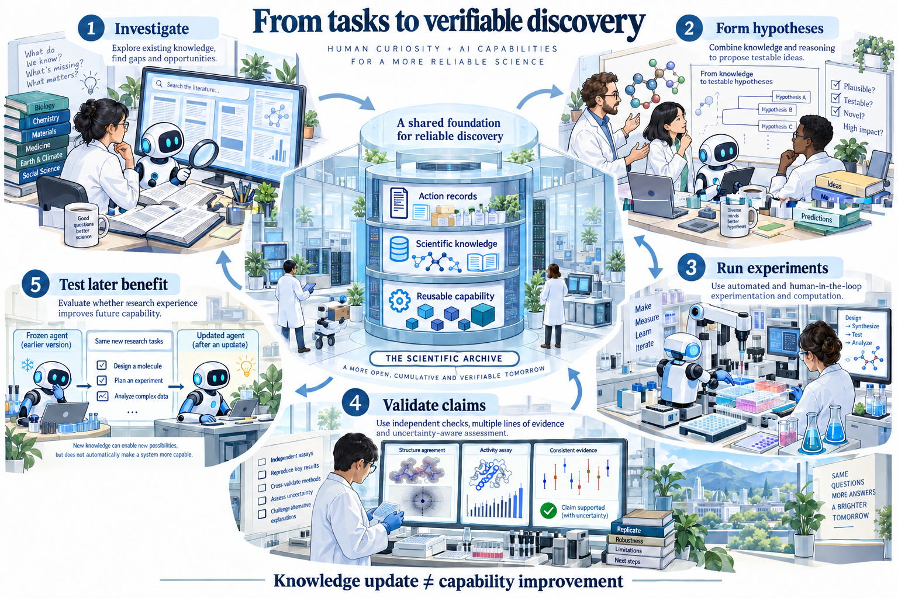
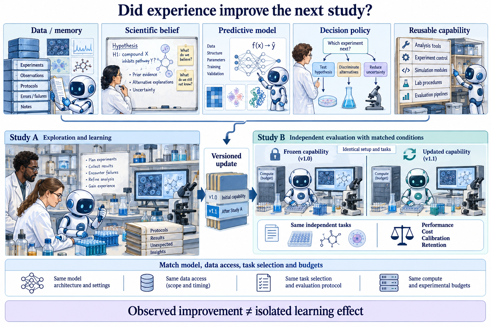
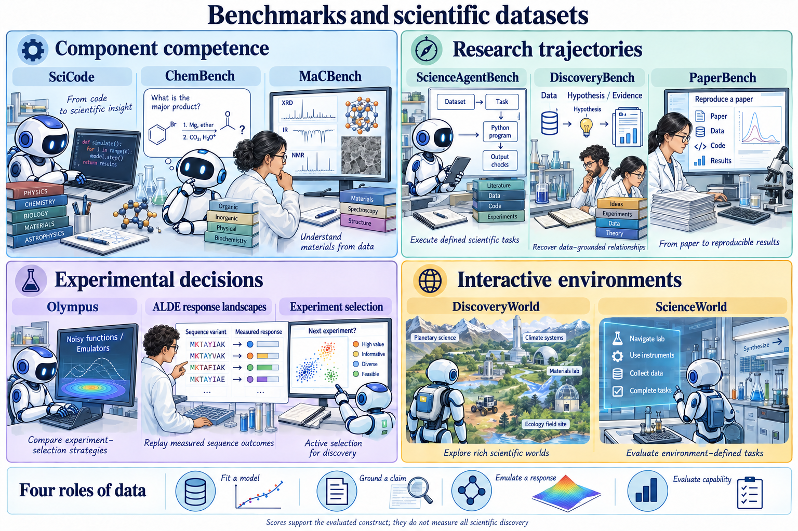

<p align="center">
  
</p>

# 🔬 Awesome Scientific Agents

### From Research Automation to Verifiable Scientific Discovery

<p>
  <a href="https://github.com/YuyangSunshine/awesome-scientific-agents/actions/workflows/catalog.yml"></a>
  <a href="https://github.com/YuyangSunshine/awesome-scientific-agents/commits/main"></a>
  <a href="#contents"></a>
  <a href="LICENSE-CONTENT.md"></a>
</p>

**[📌 Browse papers](#contents) · [🧭 Reading route](#reading-route) · [📥 BibTeX](references.bib) · [CSV](data/papers.csv) · [JSON](data/papers.json) · [🤝 Contribute](#contribute)**

<a id="introduction"></a>
## 👀 Why This Awesome List?

AI scientists and autonomous laboratories are bringing more of the research process into computational and experimental workflows—from asking questions and proposing hypotheses to selecting experiments and interpreting results. Yet a completed workflow leaves crucial questions open: who made the scientific decisions, which evidence supports the conclusion, and did the system become better at doing science?

This collection brings together research on **scientific agency, verifiable evidence, and continual learning** across the life sciences, chemistry, materials, and computational science. It accompanies our working review, *From Research Automation to Verifiable Scientific Discovery: Scientific Agency, Evidence, and Continual Learning*, and provides a living reading map that can grow alongside the field. The aim is to help readers connect systems to their scientific claims, understand what evaluations measure, and identify the experiments needed to establish progress.

> 🇨🇳 **为什么建立这个文献库？** 科研智能体与自主实验室正在连接问题提出、假设生成、实验执行与结果分析。我们希望沿着“谁决定科研行动、证据支持什么结论、系统如何获得能力改进”三条主线，把相关论文整理成便于阅读和持续补充的研究地图。

<p align="center">
  
</p>

*Figure 1 from the working review. Human researchers, agents, and scientific tools contribute to investigation, hypothesis formation, experimentation, claim validation, and testing later-study benefit. The central archive separates action records, scientific knowledge, and reusable capability. Scenes and screen traces are illustrative; knowledge update does not by itself establish capability improvement.*

**How the framework fits together.** Research operations produce questions, protocols, measurements, and conclusions. Agency locates decision authority and verification responsibility; evidence analysis traces each claim to the observations that support it; learning analysis identifies what changed and tests whether the change improved later performance. Knowledge revision can guide the next experiment, while a claim of transferable agent improvement needs a separate controlled comparison. Benchmark scores must be interpreted against the task and unit actually evaluated.

| 🤖 Agency | 🔍 Verification | 🌱 Learning |
| --- | --- | --- |
| Who proposes, selects, authorizes, and accepts scientific decisions? | What observation supports the claim, and how is it checked? | What changes, over what time scale, and does it improve later scientific tasks? |

**How the catalog is organized.** The three top-level sections are mutually exclusive. Scientific agents and systems appear once under their primary functional stage; emojis preserve additional functional contributions without duplicating the paper across subsections.

> 🇨🇳 **分类说明：** 三个大类互不重叠；科研智能体与系统按照最主要的贡献归入一个具体环节。标题后的 emoji 表示它还覆盖的其他科研功能，而不是重复收录。

### Functional contribution legend

| Emoji | Function | Scope |
| --- | --- | --- |
| 🧭 | **Action Planning** | Formulating hypotheses, designing experiments, selecting actions, and planning scientific workflows. |
| 🔬 | **Observation Acquisition** | Obtaining evidence through experiments, computation, data access, tool use, or knowledge retrieval. |
| 🔍 | **Claim Assessment** | Analyzing results, checking evidence, validating conclusions, and assessing scientific claims. |
| ♻️ | **Experience Reuse** | Retaining memory, updating knowledge or policies, and reusing experience to improve later studies. |


**Collection snapshot: 2026-10-20** · **139 unique records** · 111 marked as verified publications in the source catalog · 28 preprints or records awaiting publication verification.

<a id="contents"></a>
## 📌 Table of Contents

- [🧭 Suggested Reading Route](#reading-route)
- [📚 Surveys and Perspectives](#surveys-and-perspectives)
- [🤖 Scientific Agents and Systems](#scientific-agents-and-systems)
  - [🧭 Action Planning](#action-planning)
  - [🔬 Observation Acquisition](#observation-acquisition)
  - [🔍 Claim Assessment](#claim-assessment)
  - [♻️ Experience Reuse](#experience-reuse)
- [📊 Evaluation and Research Infrastructure](#evaluation-and-research-infrastructure)
- [🗂️ About the Collection](#about)
- [🤝 Contribute](#contribute)
- [💬 Citation and Credits](#citation)

**Within each category, records are grouped by year, newest first.** 📝 marks preprints; ⏳ marks unresolved publication status; 🛠️ marks a correction linked to its original article.

<a id="reading-route"></a>
## 🧭 Suggested Reading Route

**📚 Establish the landscape.** Compare existing coverage and definitions before evaluating a new framework.

- [Scientific discovery in the age of artificial intelligence](https://doi.org/10.1038/s41586-023-06221-2)
- [From Automation to Autonomy: A Survey on Large Language Models in Scientific Discovery](https://doi.org/10.18653/v1/2025.emnlp-main.895)
- [Self-Driving Laboratories for Chemistry and Materials Science](https://doi.org/10.1021/acs.chemrev.4c00055)

**🤖 Read scientific systems.** Compare tasks, execution environments, researcher control, and the supported scientific endpoints.

- [The Virtual Lab of AI agents designs new SARS-CoV-2 nanobodies](https://doi.org/10.1038/s41586-025-09442-9)
- [Accelerating scientific discovery with Co-Scientist](https://doi.org/10.1038/s41586-026-10644-y)
- [A multi-agent system for automating scientific discovery](https://doi.org/10.1038/s41586-026-10652-y)
- [Towards end-to-end automation of AI research](https://doi.org/10.1038/s41586-026-10265-5)

**🧪 Follow an experiment to its evidence.** Read A-Lab with its correction; distinguish synthesis, identification, novelty, and within-study optimization.

- [An autonomous laboratory for the accelerated synthesis of inorganic materials](https://doi.org/10.1038/s41586-023-06734-w)
- [Author Correction: An autonomous laboratory for the accelerated synthesis of inorganic materials](https://doi.org/10.1038/s41586-025-09992-y)
- [Active learning-assisted directed evolution](https://doi.org/10.1038/s41467-025-55987-8)

Then explore [♻️ experience reuse](#experience-reuse) and [📊 evaluation and research infrastructure](#evaluation-and-research-infrastructure). For learning, look for a frozen-versus-updated comparison, matched budgets, and tests on later tasks. For a benchmark, identify its task unit, tools, intervention rules, and scoring construct.

---

<a id="surveys-and-perspectives"></a>
## 📚 Surveys and Perspectives

Field-level syntheses, perspectives, roadmaps, and historical accounts. These records frame the field rather than representing one functional stage of a scientific system.

### 2026

- **A Survey of AI Scientists** · `arXiv` · [Paper](https://doi.org/10.48550/arXiv.2510.23045) 📝 *Preprint*
- **A Survey of Self-Evolving Agents: What, When, How, and Where to Evolve on the Path to Artificial Super Intelligence** · `TMLR` · [Paper](https://openreview.net/pdf?id=CTr3bovS5F)
- **A Survey on Evaluation of LLM-based Agents** · `FindingsACL` · [Paper](https://doi.org/10.18653/v1/2026.findings-acl.1330)
- **Agentic AI and the rise of in silico team science in biomedical research** · `NatBiotechnol` · [Paper](https://doi.org/10.1038/s41587-026-03035-1)
- **Artificial intelligence agents for biological research: a survey** · `Briefings in Bioinformatics` · [Paper](https://doi.org/10.1093/bib/bbag075)
- **Automated Scientific Discovery: From Equation Discovery to Autonomous Discovery Systems** · `MachLearn` · [Paper](https://doi.org/10.1007/s10994-025-06955-2)
- **Autonomous Research Agents: A Survey of AI Scientists and the Verification Gap** · `arXiv` · [Paper](https://arxiv.org/abs/2608.05179v1) 📝 *Preprint*
- **AutoResearch AI: Towards AI-Powered Research Automation for Scientific Discovery** · `arXiv` · [Paper](https://arxiv.org/abs/2605.23204) 📝 *Preprint*
- **Bayesian Optimization for Self-Driving Materials Laboratories: From Algorithms to Physics-Informed Workflows** · `arXiv` · [Paper](https://doi.org/10.48550/arXiv.2608.26016) 📝 *Preprint*
- **The Hitchhiker’s Guide to Autonomous Research: A Survey of Scientific Agents** · `TPAMI` · [Paper](https://doi.org/10.1109/tpami.2026.3721500)
- **The need for verification in artificial intelligence-driven scientific discovery** · `PhilTransA` · [Paper](https://doi.org/10.1098/rsta.2024.0591)
- **The Past and Future of AI Scientists** · `arXiv` · [Paper](https://arxiv.org/abs/2608.14407) 📝 *Preprint*
- **The past, present and future of self-driving laboratories** · `NatRevChem` · [Paper](https://doi.org/10.1038/s41570-026-00847-2)
- **The rise of robotics in self-driving labs** · `npjRobot` · [Paper](https://doi.org/10.1038/s44182-026-00094-z)
- **Toward Self-driving Laboratory 2.0 for Chemistry and Materials Discovery** · `Materials Horizons` · [Paper](https://doi.org/10.1039/d5mh01984b)
- **Verification-first autonomous catalysis: large language models as infrastructure for mechanism, computation, and experiment** · `npjAI` · [Paper](https://doi.org/10.1038/s44387-026-00111-4)
- **What are the limits to biomedical research acceleration through general-purpose AI?** · `SciRep` · [Paper](https://doi.org/10.1038/s41598-025-32583-w)

### 2025

- **A Comprehensive Survey of Self-Evolving AI Agents: A New Paradigm Bridging Foundation Models and Lifelong Agentic Systems** · `arXiv` · [Paper](https://arxiv.org/abs/2508.07407) 📝 *Preprint*
- **Agentic AI for Scientific Discovery: A Survey of Progress, Challenges, and Future Directions** · `arXiv` · [Paper](https://doi.org/10.48550/arXiv.2503.08979) 📝 *Preprint*
- **Autonomous ‘self-driving’ laboratories: a review of technology and policy implications** · `RSOS` · [Paper](https://doi.org/10.1098/rsos.250646)
- **Exploring the role of large language models in the scientific method: from hypothesis to discovery** · `npjAI` · [Paper](https://doi.org/10.1038/s44387-025-00019-5)
- **From AI for Science to Agentic Science: A Survey on Autonomous Scientific Discovery** · `arXiv` · [Paper](https://arxiv.org/abs/2508.14111) 📝 *Preprint*
- **From Automation to Autonomy: A Survey on Large Language Models in Scientific Discovery** · `EMNLP` · [Paper](https://doi.org/10.18653/v1/2025.emnlp-main.895)
- **Steering towards safe self-driving laboratories** · `NatRevChem` · [Paper](https://doi.org/10.1038/s41570-025-00747-x)
- **Towards Scientific Intelligence: A Survey of LLM-based Scientific Agents** · `arXiv` · [Paper](https://arxiv.org/abs/2503.24047) 📝 *Preprint*

### 2024

- **A Comprehensive Survey of Continual Learning: Theory, Method and Application** · `TPAMI` · [Paper](https://doi.org/10.1109/tpami.2024.3367329)
- **Challenges in High-Throughput Inorganic Materials Prediction and Autonomous Synthesis** · `PRXEnergy` · [Paper](https://doi.org/10.1103/prxenergy.3.011002)
- **Empowering biomedical discovery with AI agents** · `Cell` · [Paper](https://doi.org/10.1016/j.cell.2024.09.022)
- **Modern Bayesian Experimental Design** · `StatSci` · [Paper](https://doi.org/10.1214/23-sts915)
- **Review of low-cost self-driving laboratories in chemistry and materials science: the “frugal twin” concept** · `DigitDiscov` · [Paper](https://doi.org/10.1039/d3dd00223c)
- **Self-Driving Laboratories for Chemistry and Materials Science** · `ChemRev` · [Paper](https://doi.org/10.1021/acs.chemrev.4c00055)
- **Towards Scientific Discovery with Generative AI: Progress, Opportunities, and Challenges** · `arXiv` · [Paper](https://doi.org/10.48550/arXiv.2412.11427) 📝 *Preprint*

### 2023

- **Bayesian Optimization for Chemical Reactions** · `CHIMIA` · [Paper](https://doi.org/10.2533/chimia.2023.31)
- **Scientific discovery in the age of artificial intelligence** · `Nature` · [Paper](https://doi.org/10.1038/s41586-023-06221-2)
- **The rise of self-driving labs in chemical and materials sciences** · `NatSynth` · [Paper](https://doi.org/10.1038/s44160-022-00231-0)
- **What is missing in autonomous discovery: open challenges for the community** · `DigitDiscov` · [Paper](https://doi.org/10.1039/d3dd00143a)

[↑ Back to contents](#contents)

---

<a id="scientific-agents-and-systems"></a>
## 🤖 Scientific Agents and Systems

Integrated scientific agents and systems appear once under their **primary contribution**. Emojis after an entry show additional functional contributions.

<a id="action-planning"></a>
### 🧭 Action Planning

Formulating hypotheses, designing experiments, selecting actions, and planning scientific workflows.

#### 2026

- **Accelerating scientific discovery with Co-Scientist** · `Nature` · [Paper](https://doi.org/10.1038/s41586-026-10644-y) · Other contributions: 🔬 🔍
- **BioProAgent: Neuro-Symbolic Grounding for Constrained Scientific Planning** · `Proceedings of the 64th Annual Meeting of the Association for Computational Linguistics (Volume 1: Long Papers)` · [Paper](https://doi.org/10.18653/v1/2026.acl-long.1981) · Other contributions: 🔍
- **Large language models as uncertainty-calibrated optimizers for experimental discovery** · `NMI` · [Paper](https://doi.org/10.1038/s42256-026-01283-z) · Other contributions: ♻️

#### 2025

- **AutoDiscovery: Open-ended Scientific Discovery via Bayesian Surprise** · `NeurIPS` · [Paper](https://papers.neurips.cc/paper_files/paper/2025/file/23b127521af7ca7a42f5cdb7507be4f2-Paper-Conference.pdf) · Other contributions: 🔍 ♻️
- **BioDiscoveryAgent: An AI Agent for Designing Genetic Perturbation Experiments** · `ICLR` · [Paper](https://openreview.net/forum?id=HAwZGLcye3) · Other contributions: 🔬
- **Discovering state-of-the-art reinforcement learning algorithms** · `Nature` · [Paper](https://doi.org/10.1038/s41586-025-09761-x) · Other contributions: 🔬 🔍
- **ResearchAgent: Iterative Research Idea Generation over Scientific Literature with Large Language Models** · `NAACL` · [Paper](https://doi.org/10.18653/v1/2025.naacl-long.342) · Other contributions: ♻️
- **SciAgents: Automating Scientific Discovery Through Bioinspired Multi‐Agent Intelligent Graph Reasoning** · `AdvMater` · [Paper](https://doi.org/10.1002/adma.202413523) · Other contributions: 🔍 ♻️
- **The Virtual Lab of AI agents designs new SARS-CoV-2 nanobodies** · `Nature` · [Paper](https://doi.org/10.1038/s41586-025-09442-9) · Other contributions: 🔬 🔍

#### 2024

- **Race to the bottom: Bayesian optimisation for chemical problems** · `DigitDiscov` · [Paper](https://doi.org/10.1039/d3dd00234a)
- **SciMON: Scientific Inspiration Machines Optimized for Novelty** · `ACL` · [Paper](https://doi.org/10.18653/v1/2024.acl-long.18) · Other contributions: 🔍

#### 2023

- **AlphaFlow: autonomous discovery and optimization of multi-step chemistry using a self-driven fluidic lab guided by reinforcement learning** · `NatCommun` · [Paper](https://doi.org/10.1038/s41467-023-37139-y) · Other contributions: 🔬 ♻️
- **Bayesian optimization with active learning of design constraints using an entropy-based approach** · `npjComputMater` · [Paper](https://doi.org/10.1038/s41524-023-01006-7) · Other contributions: 🔬

#### 2021

- **Bayesian reaction optimization as a tool for chemical synthesis** · `Nature` · [Paper](https://doi.org/10.1038/s41586-021-03213-y) · Other contributions: 🔬
- **Gryffin: An algorithm for Bayesian optimization of categorical variables informed by expert knowledge** · `ApplPhysRev` · [Paper](https://doi.org/10.1063/5.0048164) · Other contributions: 🔬

#### 2020

- **On-the-fly closed-loop materials discovery via Bayesian active learning** · `Nature Communications` · [Paper](https://doi.org/10.1038/s41467-020-19597-w) · Other contributions: 🔬 ♻️

#### 2018

- **Phoenics: A Bayesian Optimizer for Chemistry** · `ACSCentSci` · [Paper](https://doi.org/10.1021/acscentsci.8b00307)

<a id="observation-acquisition"></a>
### 🔬 Observation Acquisition

Obtaining evidence through experiments, computation, data access, tool use, or knowledge retrieval.

#### 2026

- **Autonomous biomedical research with an artificial intelligence agent** · `Science` · [Paper](https://doi.org/10.1126/science.adz4351) · Other contributions: 🧭 🔍
- **Empowering biomedical evidence exploration and synthesis with deep knowledge graph research** · `Nature Machine Intelligence` · [Paper](https://doi.org/10.1038/s42256-026-01266-0) · Other contributions: 🔍 ♻️
- **Towards end-to-end automation of AI research** · `Nature` · [Paper](https://doi.org/10.1038/s41586-026-10265-5) · Other contributions: 🧭 🔍

#### 2025

- **Agent Laboratory: Using LLM Agents as Research Assistants** · `FindingsEMNLP` · [Paper](https://doi.org/10.18653/v1/2025.findings-emnlp.320) · Other contributions: 🧭 🔍
- **AI-Researcher: Autonomous Scientific Innovation** · `NeurIPS` · [Paper](https://proceedings.neurips.cc/paper_files/paper/2025/hash/0d904d300a105809a2114d727851e759-Abstract-Conference.html) · Other contributions: 🧭 🔍
- **An industrial automated laboratory for programmable protein evolution** · `Nature Chemical Engineering` · [Paper](https://doi.org/10.1038/s44286-025-00303-w) · Other contributions: 🧭 ♻️
- **BioAgents: Bridging the gap in bioinformatics analysis with multi-agent systems** · `Scientific Reports` · [Paper](https://doi.org/10.1038/s41598-025-25919-z) · Other contributions: 🔍
- **LabOS: The AI-XR Co-Scientist That Sees and Works With Humans** · `arXiv` · [Paper](https://arxiv.org/abs/2510.14861) 📝 *Preprint* · Other contributions: 🧭
- **The AI Scientist-v2: Workshop-Level Automated Scientific Discovery via Agentic Tree Search** · `arXiv` · [Paper](https://doi.org/10.48550/arXiv.2504.08066) 📝 *Preprint* · Other contributions: 🧭 🔍

#### 2024

- **Augmenting large language models with chemistry tools** · `Nature Machine Intelligence` · [Paper](https://doi.org/10.1038/s42256-024-00832-8) · Other contributions: 🔍
- **Autonomous mobile robots for exploratory synthetic chemistry** · `Nature` · [Paper](https://doi.org/10.1038/s41586-024-08173-7) · Other contributions: 🧭 🔍
- **CHEMREASONER: Heuristic Search over a Large Language Model's Knowledge Space using Quantum-Chemical Feedback** · `ICML` · [Paper](https://proceedings.mlr.press/v235/sprueill24a.html) · Other contributions: 🔍
- **Self-driving laboratories to autonomously navigate the protein fitness landscape** · `Nature Chemical Engineering` · [Paper](https://doi.org/10.1038/s44286-023-00002-4) · Other contributions: 🧭 ♻️
- **The AI Scientist: Towards Fully Automated Open-Ended Scientific Discovery** · `arXiv` · [Paper](https://doi.org/10.48550/arXiv.2408.06292) 📝 *Preprint* · Other contributions: 🧭 🔍

#### 2023

- **Autonomous chemical research with large language models** · `Nature` · [Paper](https://doi.org/10.1038/s41586-023-06792-0) · Other contributions: 🧭 🔍

#### 2020

- **A mobile robotic chemist** · `Nature` · [Paper](https://doi.org/10.1038/s41586-020-2442-2) · Other contributions: 🧭
- **Self-driving laboratory for accelerated discovery of thin-film materials** · `Science Advances` · [Paper](https://doi.org/10.1126/sciadv.aaz8867) · Other contributions: 🧭

#### 2018

- **Controlling an organic synthesis robot with machine learning to search for new reactivity** · `Nature` · [Paper](https://doi.org/10.1038/s41586-018-0307-8) · Other contributions: 🧭

#### 2015

- **Cheaper faster drug development validated by the repositioning of drugs against neglected tropical diseases** · `Journal of The Royal Society Interface` · [Paper](https://doi.org/10.1098/rsif.2014.1289) · Other contributions: 🧭 🔍

#### 2009

- **The Automation of Science** · `Science` · [Paper](https://doi.org/10.1126/science.1165620) · Other contributions: 🧭 🔍

#### 2004

- **Functional genomic hypothesis generation and experimentation by a robot scientist** · `Nature` · [Paper](https://doi.org/10.1038/nature02236) · Other contributions: 🧭 🔍

#### 1935

- **The Design of Experiments** · `Oliver and Boyd` · [Paper](https://archive.org/details/designofexperime00fish) · Other contributions: 🧭

<a id="claim-assessment"></a>
### 🔍 Claim Assessment

Analyzing results, checking evidence, validating conclusions, and assessing scientific claims.

#### 2025

- **AlphaEvolve: A coding agent for scientific and algorithmic discovery** · `arXiv` · [Paper](https://arxiv.org/abs/2506.13131) 📝 *Preprint* · Other contributions: 🧭 🔬
- **AutoSciLab: A Self-Driving Laboratory for Interpretable Scientific Discovery** · `Proceedings of the AAAI Conference on Artificial Intelligence` · [Paper](https://doi.org/10.1609/aaai.v39i1.31990) · Other contributions: 🧭 🔬
- **GeneAgent: self-verification language agent for gene-set analysis using domain databases** · `Nature Methods` · [Paper](https://doi.org/10.1038/s41592-025-02748-6) · Other contributions: 🔬 ♻️

#### 2024

- **Mathematical discoveries from program search with large language models** · `Nature` · [Paper](https://doi.org/10.1038/s41586-023-06924-6) · Other contributions: 🧭 🔬

#### 2023

- **An autonomous laboratory for the accelerated synthesis of inorganic materials** · `Nature` · [Paper](https://doi.org/10.1038/s41586-023-06734-w) · Other contributions: 🔬 🧭
  - 🛠️ **Author Correction: An autonomous laboratory for the accelerated synthesis of inorganic materials** · [Correction](https://doi.org/10.1038/s41586-025-09992-y)

#### 2022

- **Testing the reproducibility and robustness of the cancer biology literature by robot** · `Journal of The Royal Society Interface` · [Paper](https://doi.org/10.1098/rsif.2021.0821) · Other contributions: 🔬

#### 2020

- **AI Feynman: A physics-inspired method for symbolic regression** · `SciAdv` · [Paper](https://doi.org/10.1126/sciadv.aay2631) · Other contributions: 🔬
- **Causal Inference: What If** · `Chapman & Hall/CRC` · [Paper](https://miguelhernan.org/whatifbook)

#### 1994

- **Verification, Validation, and Confirmation of Numerical Models in the Earth Sciences** · `Science` · [Paper](https://doi.org/10.1126/science.263.5147.641) · Other contributions: 🔬

#### 1980

- **Sampling and Bayes’ Inference in Scientific Modelling and Robustness** · `Journal of the Royal Statistical Society. Series A (General)` · [Paper](https://doi.org/10.2307/2982063)

<a id="experience-reuse"></a>
### ♻️ Experience Reuse

Retaining memory, updating knowledge or policies, and reusing experience to improve later studies.

<details>
<summary>🖼️ Review figure: testing whether experience improves the next study</summary>



*Figure 5 from the working review. Distinguish data/memory, scientific beliefs, predictive models, decision policies and reusable capabilities. Test a versioned update on later independent tasks against a frozen baseline with matched model, data access, task selection and budgets; assess performance, cost, calibration and retention. This is a proposed evaluation design, not a measured learning effect.*

</details>

#### 2026

- **A multi-agent system for automating scientific discovery** · `Nature` · [Paper](https://doi.org/10.1038/s41586-026-10652-y) · Other contributions: 🧭 🔬
- **Evaluating Memory Condensation Strategies for Coding Agents in Data-Driven Scientific Discovery** · `arXiv` · [Paper](https://arxiv.org/abs/2605.18854) 📝 *Preprint* · Other contributions: 🔍
- **Evidence-Informed LLM Beliefs for Continual Scientific Discovery** · `arXiv` · [Paper](https://arxiv.org/abs/2606.29182) 📝 *Preprint* · Other contributions: 🔍
- **EvoMaster: A Foundational Evolving Agent Framework for Agentic Science at Scale** · `arXiv` · [Paper](https://arxiv.org/abs/2604.17406) 📝 *Preprint* · Other contributions: 🧭 🔍

#### 2025

- **Active learning-assisted directed evolution** · `NatCommun` · [Paper](https://doi.org/10.1038/s41467-025-55987-8) · Other contributions: 🧭 🔬
- **OriGene: A Self-Evolving Virtual Disease Biologist Automating Therapeutic Target Discovery** · `bioRxiv` · [Paper](https://doi.org/10.1101/2025.06.03.657658) 📝 *Preprint* · Other contributions: 🔬 🔍

#### 2024

- **A dynamic knowledge graph approach to distributed self-driving laboratories** · `NatCommun` · [Paper](https://doi.org/10.1038/s41467-023-44599-9) · Other contributions: 🧭 🔬
- **Loss of plasticity in deep continual learning** · `Nature` · [Paper](https://doi.org/10.1038/s41586-024-07711-7)

#### 2023

- **Accelerated Chemical Reaction Optimization Using Multi-Task Learning** · `ACSCentSci` · [Paper](https://doi.org/10.1021/acscentsci.3c00050) · Other contributions: 🧭 🔬
- **Equipping data-driven experiment planning for Self-driving Laboratories with semantic memory: case studies of transfer learning in chemical reaction optimization** · `ReactChemEng` · [Paper](https://doi.org/10.1039/d3re00008g) · Other contributions: 🧭 🔬

[↑ Back to contents](#contents)

---

<a id="evaluation-and-research-infrastructure"></a>
## 📊 Evaluation and Research Infrastructure

Benchmarks, datasets, environments, evaluation frameworks, and infrastructure for measuring or supporting scientific-agent capabilities. Functional emojis indicate the stages covered by an evaluation rather than a primary system classification.

### 🗺️ Benchmark and Dataset Resource Map

The expanded resource review organizes evaluation around four families: **component competence**, **research trajectories and replication**, **experimental decisions**, and **interactive environments**. Scientific data can fit a model, ground a claim, emulate a response, or evaluate capability; these roles require different provenance, splits and independence conditions.



*Figure 7 from the working review. Named resources illustrate distinct evaluation constructs; screen traces and equipment are schematic. A benchmark score supports its evaluated construct rather than a universal measure of scientific discovery.*

The source resource review (2026-10-12) includes **11 resources: nine marked published and two contemporaneous preprints**, plus **four dataset families**. These resources link to papers already in this collection; they do not add 11 new unique publications. [Resource ledger](data/benchmark_resources.csv) · [Dataset roles](data/dataset_roles.csv) · [Review scope](data/resource_review_scope.json).

#### 🧩 Component Competence

科研组件能力 · Coding, scientific knowledge, and multimodal interpretation.

| Resource | Evaluated task | Paper | Official resource | Interpretation boundary |
| --- | --- | --- | --- | --- |
| SciCode | Scientific coding | [Paper](https://proceedings.neurips.cc/paper_files/paper/2024/file/36850592258c8c41cecdaa3dea5ff7de-Paper-Datasets_and_Benchmarks_Track.pdf) | [Official resource](https://github.com/scicode-bench/SciCode) | Correct tested computation, not an empirical mechanism |
| ChemBench | Chemical knowledge | [Paper](https://doi.org/10.1038/s41557-025-01815-x) | [Official resource](https://github.com/lamalab-org/chembench) | Chemical competence, not autonomous laboratory execution |
| MaCBench | Multimodal interpretation | [Paper](https://doi.org/10.1038/s43588-025-00836-3) | [Official resource](https://github.com/lamalab-org/macbench) | Interpreting an experiment image is not physically performing it |
| LAB-Bench 📝 | Biology competence | [Paper](https://arxiv.org/abs/2407.10362) | [Official resource](https://huggingface.co/datasets/futurehouse/lab-bench) | Research knowledge and interpretation, not wet-lab validation |

#### 🧭 Research Trajectories and Replication

科研轨迹与复现 · Data-grounded workflows, hypothesis recovery, and paper replication.

| Resource | Evaluated task | Paper | Official resource | Interpretation boundary |
| --- | --- | --- | --- | --- |
| ScienceAgentBench | Data-driven workflows | [Paper](https://proceedings.iclr.cc/paper_files/paper/2025/file/f12b4df26344f3be803c06b555252efe-Paper-Conference.pdf) | [Official resource](https://github.com/OSU-NLP-Group/ScienceAgentBench) | Task execution, not open-ended discovery or wet-lab validity |
| DiscoveryBench | Data-driven workflows | [Paper](https://proceedings.iclr.cc/paper_files/paper/2025/file/0d70af566e69f1dfb687791ecf955e28-Paper-Conference.pdf) | [Official resource](https://github.com/allenai/discoverybench) | Dataset-grounded findings, not causal identification by default |
| PaperBench | Research replication | [Paper](https://proceedings.mlr.press/v267/starace25a.html) | [Official resource](https://github.com/openai/frontier-evals/tree/main/project/paperbench) | Replication proficiency, not novel discovery |
| BixBench 📝 | Bioinformatics workflows | [Paper](https://arxiv.org/abs/2503.00096) | [Official resource](https://github.com/Future-House/BixBench) | Analytical reasoning; score changes may reflect corpus revision |

#### 🎯 Experimental Decisions

实验决策 · Experiment selection and optimization under a resource budget.

| Resource | Evaluated task | Paper | Official resource | Interpretation boundary |
| --- | --- | --- | --- | --- |
| Olympus | Experiment planning | [Paper](https://doi.org/10.1088/2632-2153/abedc8) | [Official resource](https://github.com/the-matter-lab/olympus) | Search efficiency on a response surface, not full scientific agency |

Measured-response companion: [ALDE GB1/TrpB experimental data](https://zenodo.org/records/12196802). These landscapes support historical experiment-selection replay; they are distinct from new wet-lab trials.

#### 🌐 Interactive Environments

交互环境 · Sequential scientific tasks in simulated worlds.

| Resource | Evaluated task | Paper | Official resource | Interpretation boundary |
| --- | --- | --- | --- | --- |
| DiscoveryWorld | Interactive discovery | [Paper](https://proceedings.neurips.cc/paper_files/paper/2024/file/13836f251823945316ae067350a5c366-Paper-Datasets_and_Benchmarks_Track.pdf) | [Official resource](https://github.com/allenai/discoveryworld) | Discovery in a simulated world, not physical transfer |
| ScienceWorld | Interactive science tasks | [Paper](https://doi.org/10.18653/v1/2022.emnlp-main.775) | [Official resource](https://github.com/allenai/ScienceWorld) | Interactive science skills, not open scientific novelty |

**Version-aware reading.** Keep revised splits, evaluator releases and original paper scales separate. For ScienceAgentBench, retain the verified-split distinction; for PaperBench, distinguish full replication from Code-Dev/code-only evaluation; for BixBench, record the question-set revision. For Olympus and ALDE, distinguish measured landscapes, fitted emulators, historical replay and new wet-lab experiments. Version details are inherited from the source resource ledger; this repository reports no new benchmark execution or performance ranking.

<details>
<summary>🗃️ Four dataset families and their use conditions</summary>

| Dataset family | Role | Conditions |
| --- | --- | --- |
| Task and reference-answer corpora | Evaluate code or interpretation | Freeze answers, split and scorer; avoid training/test contamination |
| Paper-derived workflow packages | Evaluate a research workflow | Separate papers, datasets and tasks; preserve provenance and evaluator version |
| Empirical response landscapes | Fit surrogates and replay experiment selection | Endpoint-specific labels; structured splits; historical replay is not a new wet experiment |
| Simulators and fitted emulators | Evaluate sequential decisions under budget | Freeze transition rules and noise; test simulator-to-reality transfer separately |

</details>

### 📚 Papers by Year

#### 2026

- **Benchmarking AI Agents for Addressing Scientific Challenges Across Scales** · `arXiv` · [Paper](https://arxiv.org/abs/2606.12736) 📝 *Preprint* · Functional coverage: 🧭 🔍
- **Benchmarking large language models on safety risks in scientific laboratories** · `Nature Machine Intelligence` · [Paper](https://doi.org/10.1038/s42256-025-01152-1) · Functional coverage: 🧭
- **Benchmarking self-driving labs** · `Digital Discovery` · [Paper](https://doi.org/10.1039/d5dd00337g) · Functional coverage: 🧭 🔬
- **BioAgent Bench: An AI Agent Evaluation Suite for Bioinformatics** · `arXiv / ICML` · [Paper](https://arxiv.org/abs/2601.21800) 📝 *Preprint* · Functional coverage: 🔬
- **BioProBench: A Corpus and Benchmark for Biological Protocol Reasoning in Autonomous Science** · `PMLR / ICML` · [Paper](https://proceedings.mlr.press/v306/liu26cu.html) · Functional coverage: 🧭
- **BixBench3: Benchmarking AI Agents on Research-Study-Scale Computational Biology Tasks** · `arXiv` · [Paper](https://arxiv.org/abs/2608.25286) 📝 *Preprint* · Functional coverage: 🔬
- **CoPeP: Benchmarking Continual Pretraining for Protein Language Models** · `arXiv` · [Paper](https://arxiv.org/abs/2603.00253) 📝 *Preprint* · Functional coverage: ♻️
- **FIRE-Bench: Evaluating AI Agents on the Rediscovery of Scientific Insights** · `arXiv` · [Paper](https://arxiv.org/abs/2602.02905) 📝 *Preprint* · Functional coverage: 🔍
- **Formal Conjectures: An Open and Evolving Benchmark for Verified Discovery in Mathematics** · `arXiv` · [Paper](https://arxiv.org/abs/2605.13171) 📝 *Preprint* · Functional coverage: 🔍
- **LABSHIELD: A Multimodal Benchmark for Safety-Critical Reasoning and Planning in Scientific Laboratories** · `arXiv` · [Paper](https://arxiv.org/abs/2603.11987) 📝 *Preprint* · Functional coverage: 🧭
- **SEPIO LinkML Information Model and Profiling Framework** · `GitHub` · [Paper](https://github.com/sepio-framework/sepio-linkml) · Functional coverage: 🔍
- **Workflow Run RO-Crate Profiles, Version 0.6** · `Workflow Run RO-Crate` · [Paper](https://www.researchobject.org/workflow-run-crate/) · Functional coverage: ♻️

#### 2025

- **A framework for evaluating the chemical knowledge and reasoning abilities of large language models against the expertise of chemists** · `NatChem` · [Paper](https://doi.org/10.1038/s41557-025-01815-x) · Functional coverage: 🔍
- **Biomni-Eval1** · `Hugging Face Datasets` · [Paper](https://huggingface.co/datasets/biomni/Eval1) · Functional coverage: 🔬
- **BixBench: a Comprehensive Benchmark for LLM-based Agents in Computational Biology** · `arXiv` · [Paper](https://arxiv.org/abs/2503.00096) 📝 *Preprint* · Functional coverage: 🔬
- **Causal chambers as a real-world physical testbed for AI methodology** · `Nature Machine Intelligence` · [Paper](https://doi.org/10.1038/s42256-024-00964-x) · Functional coverage: 🔬 🔍
- **DiscoveryBench: Towards Data-Driven Discovery with Large Language Models** · `ICLR` · [Paper](https://proceedings.iclr.cc/paper_files/paper/2025/file/0d70af566e69f1dfb687791ecf955e28-Paper-Conference.pdf) · Functional coverage: 🔍
- **Evaluating Large Language Models in Scientific Discovery** · `arXiv` · [Paper](https://arxiv.org/abs/2512.15567) 📝 *Preprint* · Functional coverage: 🔍
- **PaperBench: Evaluating AI's Ability to Replicate AI Research** · `ICML` · [Paper](https://proceedings.mlr.press/v267/starace25a.html) · Functional coverage: 🔬 🔍
- **Probing the limitations of multimodal language models for chemistry and materials research** · `NatComputSci` · [Paper](https://doi.org/10.1038/s43588-025-00836-3) · Functional coverage: 🔬 🔍
- **Science acceleration and accessibility with self-driving labs** · `NatCommun` · [Paper](https://doi.org/10.1038/s41467-025-59231-1) · Functional coverage: 🔬
- **ScienceAgentBench: Toward Rigorous Assessment of Language Agents for Data-Driven Scientific Discovery** · `ICLR` · [Paper](https://proceedings.iclr.cc/paper_files/paper/2025/file/f12b4df26344f3be803c06b555252efe-Paper-Conference.pdf) · Functional coverage: 🔬 🔍

#### 2024

- **BioCoder: a benchmark for bioinformatics code generation with large language models** · `Bioinformatics` · [Paper](https://doi.org/10.1093/bioinformatics/btae230) · Functional coverage: 🔬
- **Data leakage inflates prediction performance in connectome-based machine learning models** · `NatCommun` · [Paper](https://doi.org/10.1038/s41467-024-46150-w) · Functional coverage: 🔍
- **DiscoveryWorld: A Virtual Environment for Developing and Evaluating Automated Scientific Discovery Agents** · `NeurIPS` · [Paper](https://proceedings.neurips.cc/paper_files/paper/2024/file/13836f251823945316ae067350a5c366-Paper-Datasets_and_Benchmarks_Track.pdf) · Functional coverage: 🧭 🔬
- **Guiding questions to avoid data leakage in biological machine learning applications** · `NatMethods` · [Paper](https://doi.org/10.1038/s41592-024-02362-y) · Functional coverage: 🔍
- **LAB-Bench: Measuring Capabilities of Language Models for Biology Research** · `arXiv` · [Paper](https://arxiv.org/abs/2407.10362) 📝 *Preprint* · Functional coverage: 🧭 🔍
- **Performance metrics to unleash the power of self-driving labs in chemistry and materials science** · `NatCommun` · [Paper](https://doi.org/10.1038/s41467-024-45569-5) · Functional coverage: 🧭 🔬
- **Recording provenance of workflow runs with RO-Crate** · `PLOS ONE` · [Paper](https://doi.org/10.1371/journal.pone.0309210) · Functional coverage: ♻️
- **SciCode: A Research Coding Benchmark Curated by Scientists** · `NeurIPS` · [Paper](https://proceedings.neurips.cc/paper_files/paper/2024/file/36850592258c8c41cecdaa3dea5ff7de-Paper-Datasets_and_Benchmarks_Track.pdf) · Functional coverage: 🔬

#### 2023

- **Building an Open Representation for Biological Protocols** · `ACM Journal on Emerging Technologies in Computing Systems` · [Paper](https://doi.org/10.1145/3604568) · Functional coverage: 🧭 ♻️
- **Leakage and the reproducibility crisis in machine-learning-based science** · `Patterns` · [Paper](https://doi.org/10.1016/j.patter.2023.100804) · Functional coverage: 🔍

#### 2022

- **Packaging research artefacts with RO-Crate** · `Data Science` · [Paper](https://doi.org/10.3233/ds-210053) · Functional coverage: ♻️
- **ScienceWorld: Is your Agent Smarter than a 5th Grader?** · `EMNLP` · [Paper](https://doi.org/10.18653/v1/2022.emnlp-main.775) · Functional coverage: 🔬

#### 2021

- **Olympus: a benchmarking framework for noisy optimization and experiment planning** · `MLST` · [Paper](https://doi.org/10.1088/2632-2153/abedc8) · Functional coverage: 🧭

#### 2019

- **Reproducibility and Replicability in Science** · `National Academies Press` · [Paper](https://doi.org/10.17226/25303)

#### 2018

- **ECO, the Evidence & Conclusion Ontology: community standard for evidence information** · `Nucleic Acids Research` · [Paper](https://doi.org/10.1093/nar/gky1036) · Functional coverage: 🔍

#### 2016

- **Decentralized provenance-aware publishing with nanopublications** · `PeerJ Computer Science` · [Paper](https://doi.org/10.7717/peerj-cs.78) · Functional coverage: ♻️ 🔍
- **SEPIO: A Semantic Model for the Integration and Analysis of Scientific Evidence** · `CEUR Workshop Proceedings` · [Paper](https://ceur-ws.org/Vol-1747/IT605_ICBO2016.pdf) · Functional coverage: 🔍
- **The Ontology for Biomedical Investigations** · `PLOS ONE` · [Paper](https://doi.org/10.1371/journal.pone.0154556) · Functional coverage: ♻️ 🔍

#### 2013

- **PROV-O: The PROV Ontology** · `W3C Recommendation` · [Paper](https://www.w3.org/TR/prov-o/) · Functional coverage: ♻️

#### 2010

- **ISA software suite: supporting standards-compliant experimental annotation and enabling curation at the community level** · `Bioinformatics` · [Paper](https://doi.org/10.1093/bioinformatics/btq415) · Functional coverage: ♻️

#### 2008

- **Evaluation of measurement data—Guide to the expression of uncertainty in measurement** · `JCGM` · [Paper](https://doi.org/10.59161/jcgm100-2008e)

[↑ Back to contents](#contents)

---

<a id="about"></a>
## 🗂️ About the Collection

This is a targeted, curated working collection exported from our review library. It is open to expansion and does not claim exhaustive field coverage. Publication status and version metadata preserve the source-catalog assessment; inclusion does not establish a scientific claim or independent reproduction. Continual-learning entries include methodological background, and benchmark entries span distinct evaluation tasks.

The source snapshot contains 139 unique records; its working main text cited 125 of them. The remaining 14 records were retained from the earlier repository so the collection can continue growing beyond the manuscript bibliography. Journal reference requirements continue to apply to the manuscript.

Papers are accessed through their original publication or preprint pages. Related versions of a work should be connected; genuine follow-up studies and corrections remain distinct. Read the A-Lab article alongside its author correction rather than carrying forward an earlier result without its update.

<details>
<summary>📂 Source-library access and metadata</summary>

The source snapshot had full text for 86 unique records and lacked full text for 53. These are source-library access counts. Full-text availability does not establish complete evidence coding or independent validation.

The dataset preserves publication evidence, metadata sources, section membership, primary functional assignment, additional functional contributions, and the PDF version held by the source library. The previous `wp_membership` values remain as `legacy_wp_membership` for migration traceability. Bibliographic record keys remain in the downloadable datasets for maintenance and BibTeX matching.

**Full text unavailable in the current source-library export:**

- [The past, present and future of self-driving laboratories](https://doi.org/10.1038/s41570-026-00847-2)
- [Agentic AI and the rise of in silico team science in biomedical research](https://doi.org/10.1038/s41587-026-03035-1)
- [The rise of self-driving labs in chemical and materials sciences](https://doi.org/10.1038/s44160-022-00231-0)
- [Steering towards safe self-driving laboratories](https://doi.org/10.1038/s41570-025-00747-x)
- [What is missing in autonomous discovery: open challenges for the community](https://doi.org/10.1039/d3dd00143a)
- [Review of low-cost self-driving laboratories in chemistry and materials science: the “frugal twin” concept](https://doi.org/10.1039/d3dd00223c)
- [Autonomous ‘self-driving’ laboratories: a review of technology and policy implications](https://doi.org/10.1098/rsos.250646)
- [Guiding questions to avoid data leakage in biological machine learning applications](https://doi.org/10.1038/s41592-024-02362-y)
- [OriGene: A Self-Evolving Virtual Disease Biologist Automating Therapeutic Target Discovery](https://doi.org/10.1101/2025.06.03.657658)
- [Equipping data-driven experiment planning for Self-driving Laboratories with semantic memory: case studies of transfer learning in chemical reaction optimization](https://doi.org/10.1039/d3re00008g)
- [The Hitchhiker’s Guide to Autonomous Research: A Survey of Scientific Agents](https://doi.org/10.1109/tpami.2026.3721500)
- [Functional genomic hypothesis generation and experimentation by a robot scientist](https://doi.org/10.1038/nature02236)
- [The Automation of Science](https://doi.org/10.1126/science.1165620)
- [Cheaper faster drug development validated by the repositioning of drugs against neglected tropical diseases](https://doi.org/10.1098/rsif.2014.1289)
- [Testing the reproducibility and robustness of the cancer biology literature by robot](https://doi.org/10.1098/rsif.2021.0821)
- [Self-driving laboratories to autonomously navigate the protein fitness landscape](https://doi.org/10.1038/s44286-023-00002-4)
- [Empowering biomedical discovery with AI agents](https://doi.org/10.1016/j.cell.2024.09.022)
- [Artificial intelligence agents for biological research: a survey](https://doi.org/10.1093/bib/bbag075)
- [On-the-fly closed-loop materials discovery via Bayesian active learning](https://doi.org/10.1038/s41467-020-19597-w)
- [BioProAgent: Neuro-Symbolic Grounding for Constrained Scientific Planning](https://doi.org/10.18653/v1/2026.acl-long.1981)
- [Empowering biomedical evidence exploration and synthesis with deep knowledge graph research](https://doi.org/10.1038/s42256-026-01266-0)
- [Causal Inference: What If](https://miguelhernan.org/whatifbook)
- [GeneAgent: self-verification language agent for gene-set analysis using domain databases](https://doi.org/10.1038/s41592-025-02748-6)
- [Augmenting large language models with chemistry tools](https://doi.org/10.1038/s42256-024-00832-8)
- [Autonomous biomedical research with an artificial intelligence agent](https://doi.org/10.1126/science.adz4351)
- [Verification, Validation, and Confirmation of Numerical Models in the Earth Sciences](https://doi.org/10.1126/science.263.5147.641)
- [Controlling an organic synthesis robot with machine learning to search for new reactivity](https://doi.org/10.1038/s41586-018-0307-8)
- [Self-driving laboratory for accelerated discovery of thin-film materials](https://doi.org/10.1126/sciadv.aaz8867)
- [The Design of Experiments](https://archive.org/details/designofexperime00fish)
- [Evaluation of measurement data—Guide to the expression of uncertainty in measurement](https://doi.org/10.59161/jcgm100-2008e)
- [Reproducibility and Replicability in Science](https://doi.org/10.17226/25303)
- [AutoSciLab: A Self-Driving Laboratory for Interpretable Scientific Discovery](https://doi.org/10.1609/aaai.v39i1.31990)
- [Sampling and Bayes’ Inference in Scientific Modelling and Robustness](https://doi.org/10.2307/2982063)
- [An industrial automated laboratory for programmable protein evolution](https://doi.org/10.1038/s44286-025-00303-w)
- [BioDiscoveryAgent: An AI Agent for Designing Genetic Perturbation Experiments](https://openreview.net/forum?id=HAwZGLcye3)
- [BioAgents: Bridging the gap in bioinformatics analysis with multi-agent systems](https://doi.org/10.1038/s41598-025-25919-z)
- [Benchmarking self-driving labs](https://doi.org/10.1039/d5dd00337g)
- [BioProBench: A Corpus and Benchmark for Biological Protocol Reasoning in Autonomous Science](https://proceedings.mlr.press/v306/liu26cu.html)
- [Benchmarking large language models on safety risks in scientific laboratories](https://doi.org/10.1038/s42256-025-01152-1)
- [BioCoder: a benchmark for bioinformatics code generation with large language models](https://doi.org/10.1093/bioinformatics/btae230)
- [Biomni-Eval1](https://huggingface.co/datasets/biomni/Eval1)
- [Causal chambers as a real-world physical testbed for AI methodology](https://doi.org/10.1038/s42256-024-00964-x)
- [ISA software suite: supporting standards-compliant experimental annotation and enabling curation at the community level](https://doi.org/10.1093/bioinformatics/btq415)
- [The Ontology for Biomedical Investigations](https://doi.org/10.1371/journal.pone.0154556)
- [Building an Open Representation for Biological Protocols](https://doi.org/10.1145/3604568)
- [PROV-O: The PROV Ontology](https://www.w3.org/TR/prov-o/)
- [Packaging research artefacts with RO-Crate](https://doi.org/10.3233/ds-210053)
- [Recording provenance of workflow runs with RO-Crate](https://doi.org/10.1371/journal.pone.0309210)
- [Workflow Run RO-Crate Profiles, Version 0.6](https://www.researchobject.org/workflow-run-crate/)
- [ECO, the Evidence & Conclusion Ontology: community standard for evidence information](https://doi.org/10.1093/nar/gky1036)
- [Decentralized provenance-aware publishing with nanopublications](https://doi.org/10.7717/peerj-cs.78)
- [SEPIO LinkML Information Model and Profiling Framework](https://github.com/sepio-framework/sepio-linkml)
- [Toward Self-driving Laboratory 2.0 for Chemistry and Materials Discovery](https://doi.org/10.1039/d5mh01984b)

</details>

<a id="contribute"></a>
## 🤝 Contribute

Missing a relevant paper, a correction, or a newer publication version? [Suggest a paper](https://github.com/YuyangSunshine/awesome-scientific-agents/issues/new?template=paper.yml) or open a pull request. Include the primary source, scientific relevance, main section, primary function where applicable, and version information. See [CONTRIBUTING.md](CONTRIBUTING.md) for the data format and maintenance steps.

We welcome broader disciplinary coverage, verified code and dataset links, and evidence notes grounded in specific source locations. Keep scientific claims tied to observations and interpretation limits.

<details>
<summary>🛠️ Regenerate the catalog</summary>

Update `data/papers.json` and `references.bib`, then run:

```bash
python scripts/build_catalog.py
python scripts/validate.py
```

These commands regenerate this single-page README and CSV export. The maintainer can refresh from a review-aligned private working library with `python scripts/build_catalog.py --import-from /path/to/2026-agent-review`; reconcile community additions before importing.

</details>

<a id="citation"></a>
## 💬 Citation and Credits

Cite the original paper for a research claim. To cite the collection itself, use [CITATION.cff](CITATION.cff).

The reading-list presentation draws inspiration from [Awesome-Agent-Papers](https://github.com/luo-junyu/Awesome-Agent-Papers), [Awesome-LLM-Scientific-Discovery](https://github.com/HKUST-KnowComp/Awesome-LLM-Scientific-Discovery), and [awesome-llm-agents](https://github.com/kaushikb11/awesome-llm-agents). The introduction, organization around our review questions, and logo were created for this collection.

Original repository content and curation: [CC BY 4.0](LICENSE-CONTENT.md). Maintenance scripts: [MIT](LICENSE). Linked papers retain their original licenses. The logo and earlier repository overview drafts were generated with OpenAI's built-in image generation tool; the [prompts](assets/prompts.json) preserve their design history.

Figures 1, 5 and 7 are reproduced from the working review's existing figure collection. Their [source manifest](assets/review-figures.json) preserves the source-paper anchors, original filenames, and qualitative interpretation. They illustrate scientific workflows, evaluation designs and resource constructs rather than report new experimental results.

[↑ Back to contents](#contents)
