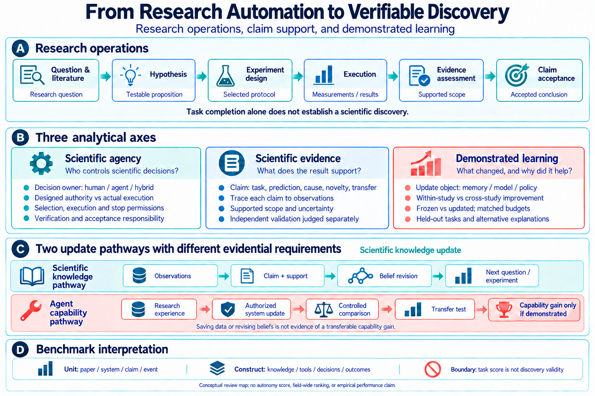

<p align="center">
  
</p>

# 🔬 Awesome Scientific Agents

### From Research Automation to Verifiable Scientific Discovery

<p>
  <a href="https://github.com/YuyangSunshine/awesome-scientific-agents/actions/workflows/catalog.yml"></a>
  <a href="https://github.com/YuyangSunshine/awesome-scientific-agents/commits/main"></a>
  <a href="#contents"></a>
  <a href="LICENSE-CONTENT.md"></a>
  <a href="https://github.com/YuyangSunshine/awesome-scientific-agents/issues"></a>
</p>

**[📌 Browse papers](#contents) · [🧭 Reading route](#reading-route) · [📥 BibTeX](references.bib) · [CSV](data/papers.csv) · [JSON](data/papers.json) · [🤝 Contribute](#contribute)**

<a id="introduction"></a>
## 👀 Why This Awesome List?

AI scientists and autonomous laboratories are bringing more of the research process into computational and experimental workflows—from asking questions and proposing hypotheses to selecting experiments and interpreting results. Yet a completed workflow leaves crucial questions open: who made the scientific decisions, which evidence supports the conclusion, and did the system become better at doing science?

This collection brings together research on **scientific agency, verifiable evidence, and continual learning** across the life sciences, chemistry, materials, and computational science. It accompanies our working review, *From Research Automation to Verifiable Scientific Discovery: Scientific Agency, Evidence, and Continual Learning*, and provides a living reading map that can grow alongside the field. The aim is to help readers connect systems to their scientific claims, understand what evaluations measure, and identify the experiments needed to establish progress.

> 🇨🇳 **为什么建立这个文献库？** 科研智能体与自主实验室正在连接问题提出、假设生成、实验执行与结果分析。我们希望沿着“谁决定科研行动、证据支持什么结论、系统如何获得能力改进”三条主线，把相关论文整理成便于阅读和持续补充的研究地图。

<p align="center">
  
</p>

*Read the map from research operations to their assessment: three analytical axes apply across the workflow; scientific knowledge revision and agent capability improvement follow distinct update pathways; benchmark interpretation depends on the evaluated unit and construct.*

**How the framework fits together.** Research operations produce questions, protocols, measurements, and conclusions. Agency locates decision authority and verification responsibility; evidence analysis traces each claim to the observations that support it; learning analysis identifies what changed and tests whether the change improved later performance. Knowledge revision can guide the next experiment, while a claim of transferable agent improvement needs a separate controlled comparison. Benchmark scores must be interpreted against the task and unit actually evaluated.

| 🤖 Agency | 🔍 Verification | 🌱 Learning |
| --- | --- | --- |
| Who proposes, selects, authorizes, and accepts scientific decisions? | What observation supports the claim, and how is it checked? | What changes, over what time scale, and does it improve later scientific tasks? |

**Collection snapshot: 2026-10-12** · **90 unique papers** · 68 marked as verified publications in the source catalog · 22 preprints or records awaiting publication verification.

<a id="contents"></a>
## 📌 Table of Contents

- [🧭 Suggested Reading Route](#reading-route)
- [📚 Surveys and Perspectives](#surveys)
- [🤖 AI Scientists and Scientific Agents](#scientific-agents)
- [🧪 Autonomous Laboratories](#autonomous-labs)
- [🔍 Scientific Reasoning and Verification](#scientific-evidence)
- [🎯 Active Learning and Experiment Design](#experiment-design)
- [🌱 Continual Learning and Agent Improvement](#continual-learning)
- [📊 Benchmarks and Scientific Evaluation](#benchmarks)
- [🗂️ About the Collection](#about)
- [🤝 Contribute](#contribute)
- [💬 Citation and Credits](#citation)

**Within each topic, papers are grouped by year, newest first.** 📝 marks preprints; ⏳ marks unresolved publication status; 🛠️ marks corrections. Other entries are marked published in the source catalog. Cross-topic listings are intentional and do not add to the unique-paper count.

<a id="reading-route"></a>
## 🧭 Suggested Reading Route

**📚 Establish the landscape.** Compare existing coverage and definitions before evaluating a new framework.

- [Scientific discovery in the age of artificial intelligence](https://doi.org/10.1038/s41586-023-06221-2)
- [From Automation to Autonomy: A Survey on Large Language Models in Scientific Discovery](https://doi.org/10.18653/v1/2025.emnlp-main.895)
- [Self-Driving Laboratories for Chemistry and Materials Science](https://doi.org/10.1021/acs.chemrev.4c00055)

**🤖 Read scientific systems.** Compare tasks, execution environments, researcher control, and the supported scientific endpoints.

- [The Virtual Lab of AI agents designs new SARS-CoV-2 nanobodies](https://doi.org/10.1038/s41586-025-09442-9)
- [Accelerating scientific discovery with Co-Scientist](https://doi.org/10.1038/s41586-026-10644-y)
- [A multi-agent system for automating scientific discovery](https://doi.org/10.1038/s41586-026-10652-y)
- [Towards end-to-end automation of AI research](https://doi.org/10.1038/s41586-026-10265-5)

**🧪 Follow an experiment to its evidence.** Read A-Lab with its correction; distinguish synthesis, identification, novelty, and within-study optimization.

- [An autonomous laboratory for the accelerated synthesis of inorganic materials](https://doi.org/10.1038/s41586-023-06734-w)
- [Author Correction: An autonomous laboratory for the accelerated synthesis of inorganic materials](https://doi.org/10.1038/s41586-025-09992-y)
- [Active learning-assisted directed evolution](https://doi.org/10.1038/s41467-025-55987-8)

Then explore [🌱 continual learning](#continual-learning) and [📊 benchmarks](#benchmarks). For learning, look for a frozen-versus-updated comparison, matched budgets, and tests on later tasks. For a benchmark, identify its task unit, tools, intervention rules, and scoring construct.

---

<a id="surveys"></a>
## 📚 Surveys and Perspectives

Start with the broader landscape: scientific discovery, agentic workflows, and self-driving laboratories. This section preserves the original survey collection; topic-specific reviews also appear below.

### 2026

- **Agentic AI and the rise of in silico team science in biomedical research** · `NatBiotechnol` · [Paper](https://doi.org/10.1038/s41587-026-03035-1)
- **Autonomous Research Agents: A Survey of AI Scientists and the Verification Gap** · `arXiv` · [Paper](https://arxiv.org/abs/2608.05179v1) 📝 *Preprint*
- **AutoResearch AI: Towards AI-Powered Research Automation for Scientific Discovery** · `arXiv` · [Paper](https://arxiv.org/abs/2605.23204) 📝 *Preprint*
- **The Hitchhiker’s Guide to Autonomous Research: A Survey of Scientific Agents** · `TPAMI` · [Paper](https://doi.org/10.1109/tpami.2026.3721500)
- **The past, present and future of self-driving laboratories** · `NatRevChem` · [Paper](https://doi.org/10.1038/s41570-026-00847-2)
- **What are the limits to biomedical research acceleration through general-purpose AI?** · `SciRep` · [Paper](https://doi.org/10.1038/s41598-025-32583-w)

### 2025

- **From AI for Science to Agentic Science: A Survey on Autonomous Scientific Discovery** · `arXiv` · [Paper](https://arxiv.org/abs/2508.14111) 📝 *Preprint*
- **From Automation to Autonomy: A Survey on Large Language Models in Scientific Discovery** · `EMNLP` · [Paper](https://doi.org/10.18653/v1/2025.emnlp-main.895)
- **Science acceleration and accessibility with self-driving labs** · `NatCommun` · [Paper](https://doi.org/10.1038/s41467-025-59231-1)

### 2023

- **Scientific discovery in the age of artificial intelligence** · `Nature` · [Paper](https://doi.org/10.1038/s41586-023-06221-2)

[↑ Back to contents](#contents)

---

<a id="scientific-agents"></a>
## 🤖 AI Scientists and Scientific Agents

Systems for research ideation, hypothesis generation, computational experimentation, and coordinated scientific workflows. Read each system in the context of its task, environment, and researcher involvement.

### 2026

- **A multi-agent system for automating scientific discovery** · `Nature` · [Paper](https://doi.org/10.1038/s41586-026-10652-y)
- **A Survey of AI Scientists** · `arXiv` · [Paper](https://doi.org/10.48550/arXiv.2510.23045) 📝 *Preprint*
- **Accelerating scientific discovery with Co-Scientist** · `Nature` · [Paper](https://doi.org/10.1038/s41586-026-10644-y)
- **Automated Scientific Discovery: From Equation Discovery to Autonomous Discovery Systems** · `MachLearn` · [Paper](https://doi.org/10.1007/s10994-025-06955-2)
- **Towards end-to-end automation of AI research** · `Nature` · [Paper](https://doi.org/10.1038/s41586-026-10265-5)

### 2025

- **Agent Laboratory: Using LLM Agents as Research Assistants** · `FindingsEMNLP` · [Paper](https://doi.org/10.18653/v1/2025.findings-emnlp.320)
- **Agentic AI for Scientific Discovery: A Survey of Progress, Challenges, and Future Directions** · `arXiv` · [Paper](https://doi.org/10.48550/arXiv.2503.08979) 📝 *Preprint*
- **AI-Researcher: Autonomous Scientific Innovation** · `NeurIPS` · [Paper](https://proceedings.neurips.cc/paper_files/paper/2025/hash/0d904d300a105809a2114d727851e759-Abstract-Conference.html)
- **From AI for Science to Agentic Science: A Survey on Autonomous Scientific Discovery** · `arXiv` · [Paper](https://arxiv.org/abs/2508.14111) 📝 *Preprint*
- **From Automation to Autonomy: A Survey on Large Language Models in Scientific Discovery** · `EMNLP` · [Paper](https://doi.org/10.18653/v1/2025.emnlp-main.895)
- **ResearchAgent: Iterative Research Idea Generation over Scientific Literature with Large Language Models** · `NAACL` · [Paper](https://doi.org/10.18653/v1/2025.naacl-long.342)
- **SciAgents: Automating Scientific Discovery Through Bioinspired Multi‐Agent Intelligent Graph Reasoning** · `AdvMater` · [Paper](https://doi.org/10.1002/adma.202413523)
- **The AI Scientist-v2: Workshop-Level Automated Scientific Discovery via Agentic Tree Search** · `arXiv` · [Paper](https://doi.org/10.48550/arXiv.2504.08066) 📝 *Preprint*
- **The Virtual Lab of AI agents designs new SARS-CoV-2 nanobodies** · `Nature` · [Paper](https://doi.org/10.1038/s41586-025-09442-9)

### 2024

- **The AI Scientist: Towards Fully Automated Open-Ended Scientific Discovery** · `arXiv` · [Paper](https://doi.org/10.48550/arXiv.2408.06292) 📝 *Preprint*

[↑ Back to contents](#contents)

---

<a id="autonomous-labs"></a>
## 🧪 Autonomous Laboratories

Self-driving laboratories and embodied scientific systems in chemistry, materials, and the life sciences. For the A-Lab study, read the original article together with its author correction.

### 2026

- **Author Correction: An autonomous laboratory for the accelerated synthesis of inorganic materials** · `Nature` · [Paper](https://doi.org/10.1038/s41586-025-09992-y) 🛠️ *Author correction*
- **The past, present and future of self-driving laboratories** · `NatRevChem` · [Paper](https://doi.org/10.1038/s41570-026-00847-2)
- **The rise of robotics in self-driving labs** · `npjRobot` · [Paper](https://doi.org/10.1038/s44182-026-00094-z)

### 2025

- **Autonomous ‘self-driving’ laboratories: a review of technology and policy implications** · `RSOS` · [Paper](https://doi.org/10.1098/rsos.250646)
- **Science acceleration and accessibility with self-driving labs** · `NatCommun` · [Paper](https://doi.org/10.1038/s41467-025-59231-1)
- **Steering towards safe self-driving laboratories** · `NatRevChem` · [Paper](https://doi.org/10.1038/s41570-025-00747-x)

### 2024

- **A dynamic knowledge graph approach to distributed self-driving laboratories** · `NatCommun` · [Paper](https://doi.org/10.1038/s41467-023-44599-9)
- **Autonomous mobile robots for exploratory synthetic chemistry** · `Nature` · [Paper](https://doi.org/10.1038/s41586-024-08173-7)
- **Performance metrics to unleash the power of self-driving labs in chemistry and materials science** · `NatCommun` · [Paper](https://doi.org/10.1038/s41467-024-45569-5)
- **Review of low-cost self-driving laboratories in chemistry and materials science: the “frugal twin” concept** · `DigitDiscov` · [Paper](https://doi.org/10.1039/d3dd00223c)
- **Self-Driving Laboratories for Chemistry and Materials Science** · `ChemRev` · [Paper](https://doi.org/10.1021/acs.chemrev.4c00055)

### 2023

- **AlphaFlow: autonomous discovery and optimization of multi-step chemistry using a self-driven fluidic lab guided by reinforcement learning** · `NatCommun` · [Paper](https://doi.org/10.1038/s41467-023-37139-y)
- **An autonomous laboratory for the accelerated synthesis of inorganic materials** · `Nature` · [Paper](https://doi.org/10.1038/s41586-023-06734-w)
- **Autonomous chemical research with large language models** · `Nature` · [Paper](https://doi.org/10.1038/s41586-023-06792-0)
- **The rise of self-driving labs in chemical and materials sciences** · `NatSynth` · [Paper](https://doi.org/10.1038/s44160-022-00231-0)
- **What is missing in autonomous discovery: open challenges for the community** · `DigitDiscov` · [Paper](https://doi.org/10.1039/d3dd00143a)

### 2020

- **A mobile robotic chemist** · `Nature` · [Paper](https://doi.org/10.1038/s41586-020-2442-2)

[↑ Back to contents](#contents)

---

<a id="scientific-evidence"></a>
## 🔍 Scientific Reasoning and Verification

Scientific reasoning, evidence assessment, reproducibility, and validation. Ask which observation supports which claim, and whether the claim has been independently tested.

### 2026

- **Author Correction: An autonomous laboratory for the accelerated synthesis of inorganic materials** · `Nature` · [Paper](https://doi.org/10.1038/s41586-025-09992-y) 🛠️ *Author correction*
- **The need for verification in artificial intelligence-driven scientific discovery** · `PhilTransA` · [Paper](https://doi.org/10.1098/rsta.2024.0591)
- **Verification-first autonomous catalysis: large language models as infrastructure for mechanism, computation, and experiment** · `npjAI` · [Paper](https://doi.org/10.1038/s44387-026-00111-4)

### 2025

- **Exploring the role of large language models in the scientific method: from hypothesis to discovery** · `npjAI` · [Paper](https://doi.org/10.1038/s44387-025-00019-5)

### 2024

- **CHEMREASONER: Heuristic Search over a Large Language Model's Knowledge Space using Quantum-Chemical Feedback** · `ICML` · [Paper](https://proceedings.mlr.press/v235/sprueill24a.html)
- **Data leakage inflates prediction performance in connectome-based machine learning models** · `NatCommun` · [Paper](https://doi.org/10.1038/s41467-024-46150-w)
- **Guiding questions to avoid data leakage in biological machine learning applications** · `NatMethods` · [Paper](https://doi.org/10.1038/s41592-024-02362-y)
- **Mathematical discoveries from program search with large language models** · `Nature` · [Paper](https://doi.org/10.1038/s41586-023-06924-6)
- **SciMON: Scientific Inspiration Machines Optimized for Novelty** · `ACL` · [Paper](https://doi.org/10.18653/v1/2024.acl-long.18)
- **Towards Scientific Discovery with Generative AI: Progress, Opportunities, and Challenges** · `arXiv` · [Paper](https://doi.org/10.48550/arXiv.2412.11427) 📝 *Preprint*

### 2023

- **An autonomous laboratory for the accelerated synthesis of inorganic materials** · `Nature` · [Paper](https://doi.org/10.1038/s41586-023-06734-w)
- **Leakage and the reproducibility crisis in machine-learning-based science** · `Patterns` · [Paper](https://doi.org/10.1016/j.patter.2023.100804)
- **Scientific discovery in the age of artificial intelligence** · `Nature` · [Paper](https://doi.org/10.1038/s41586-023-06221-2)

### 2020

- **AI Feynman: A physics-inspired method for symbolic regression** · `SciAdv` · [Paper](https://doi.org/10.1126/sciadv.aay2631)

[↑ Back to contents](#contents)

---

<a id="experiment-design"></a>
## 🎯 Active Learning and Experiment Design

Active learning, Bayesian optimization, and data-efficient experiment selection. Distinguish optimization within a study from improvement that transfers to subsequent scientific tasks.

### 2026

- **Bayesian Optimization for Self-Driving Materials Laboratories: From Algorithms to Physics-Informed Workflows** · `arXiv` · [Paper](https://doi.org/10.48550/arXiv.2608.26016) 📝 *Preprint*
- **Large language models as uncertainty-calibrated optimizers for experimental discovery** · `NMI` · [Paper](https://doi.org/10.1038/s42256-026-01283-z)

### 2025

- **Active learning-assisted directed evolution** · `NatCommun` · [Paper](https://doi.org/10.1038/s41467-025-55987-8)

### 2024

- **Modern Bayesian Experimental Design** · `StatSci` · [Paper](https://doi.org/10.1214/23-sts915)
- **Race to the bottom: Bayesian optimisation for chemical problems** · `DigitDiscov` · [Paper](https://doi.org/10.1039/d3dd00234a)
- **Review of low-cost self-driving laboratories in chemistry and materials science: the “frugal twin” concept** · `DigitDiscov` · [Paper](https://doi.org/10.1039/d3dd00223c)
- **Self-Driving Laboratories for Chemistry and Materials Science** · `ChemRev` · [Paper](https://doi.org/10.1021/acs.chemrev.4c00055)

### 2023

- **Accelerated Chemical Reaction Optimization Using Multi-Task Learning** · `ACSCentSci` · [Paper](https://doi.org/10.1021/acscentsci.3c00050)
- **Bayesian Optimization for Chemical Reactions** · `CHIMIA` · [Paper](https://doi.org/10.2533/chimia.2023.31)
- **Bayesian optimization with active learning of design constraints using an entropy-based approach** · `npjComputMater` · [Paper](https://doi.org/10.1038/s41524-023-01006-7)

### 2021

- **Bayesian reaction optimization as a tool for chemical synthesis** · `Nature` · [Paper](https://doi.org/10.1038/s41586-021-03213-y)
- **Gryffin: An algorithm for Bayesian optimization of categorical variables informed by expert knowledge** · `ApplPhysRev` · [Paper](https://doi.org/10.1063/5.0048164)
- **Olympus: a benchmarking framework for noisy optimization and experiment planning** · `MLST` · [Paper](https://doi.org/10.1088/2632-2153/abedc8)

### 2018

- **Phoenics: A Bayesian Optimizer for Chemistry** · `ACSCentSci` · [Paper](https://doi.org/10.1021/acscentsci.8b00307)

[↑ Back to contents](#contents)

---

<a id="continual-learning"></a>
## 🌱 Continual Learning and Agent Improvement

Scientific knowledge updates, memory, model and policy adaptation, and transferable capability improvement. Relevant background methods are included; their presence does not establish scientific-agent learning.

### 2026

- **A Survey of Self-Evolving Agents: What, When, How, and Where to Evolve on the Path to Artificial Super Intelligence** · `TMLR` · [Paper](https://openreview.net/pdf)
- **Accelerating scientific discovery with Co-Scientist** · `Nature` · [Paper](https://doi.org/10.1038/s41586-026-10644-y)
- **CoPeP: Benchmarking Continual Pretraining for Protein Language Models** · `arXiv` · [Paper](https://arxiv.org/abs/2603.00253) 📝 *Preprint*
- **Evaluating Memory Condensation Strategies for Coding Agents in Data-Driven Scientific Discovery** · `arXiv` · [Paper](https://arxiv.org/abs/2605.18854) 📝 *Preprint*
- **Evidence-Informed LLM Beliefs for Continual Scientific Discovery** · `arXiv` · [Paper](https://arxiv.org/abs/2606.29182) 📝 *Preprint*
- **EvoMaster: A Foundational Evolving Agent Framework for Agentic Science at Scale** · `arXiv` · [Paper](https://arxiv.org/abs/2604.17406) 📝 *Preprint*

### 2025

- **A Comprehensive Survey of Self-Evolving AI Agents: A New Paradigm Bridging Foundation Models and Lifelong Agentic Systems** · `arXiv` · [Paper](https://arxiv.org/abs/2508.07407) 📝 *Preprint*
- **AlphaEvolve: A coding agent for scientific and algorithmic discovery** · `arXiv` · [Paper](https://arxiv.org/abs/2506.13131) 📝 *Preprint*
- **Discovering state-of-the-art reinforcement learning algorithms** · `Nature` · [Paper](https://doi.org/10.1038/s41586-025-09761-x)
- **LabOS: The AI-XR Co-Scientist That Sees and Works With Humans** · `arXiv` · [Paper](https://arxiv.org/abs/2510.14861) 📝 *Preprint*
- **OriGene: A Self-Evolving Virtual Disease Biologist Automating Therapeutic Target Discovery** · `bioRxiv` · [Paper](https://doi.org/10.1101/2025.06.03.657658) 📝 *Preprint*

### 2024

- **A Comprehensive Survey of Continual Learning: Theory, Method and Application** · `TPAMI` · [Paper](https://doi.org/10.1109/tpami.2024.3367329)
- **Loss of plasticity in deep continual learning** · `Nature` · [Paper](https://doi.org/10.1038/s41586-024-07711-7)
- **Mathematical discoveries from program search with large language models** · `Nature` · [Paper](https://doi.org/10.1038/s41586-023-06924-6)

### 2023

- **Equipping data-driven experiment planning for Self-driving Laboratories with semantic memory: case studies of transfer learning in chemical reaction optimization** · `ReactChemEng` · [Paper](https://doi.org/10.1039/d3re00008g)

[↑ Back to contents](#contents)

---

<a id="benchmarks"></a>
## 📊 Benchmarks and Scientific Evaluation

Evaluation of scientific knowledge, reasoning, tool use, and research workflows. Benchmarks measure different constructs and should be interpreted with their task definitions and scoring conditions.

### 2026

- **A Survey on Evaluation of LLM-based Agents** · `FindingsACL` · [Paper](https://doi.org/10.18653/v1/2026.findings-acl.1330)
- **Author Correction: An autonomous laboratory for the accelerated synthesis of inorganic materials** · `Nature` · [Paper](https://doi.org/10.1038/s41586-025-09992-y) 🛠️ *Author correction*
- **Formal Conjectures: An Open and Evolving Benchmark for Verified Discovery in Mathematics** · `arXiv` · [Paper](https://arxiv.org/abs/2605.13171) 📝 *Preprint*

### 2025

- **A framework for evaluating the chemical knowledge and reasoning abilities of large language models against the expertise of chemists** · `NatChem` · [Paper](https://doi.org/10.1038/s41557-025-01815-x)
- **AutoDiscovery: Open-ended Scientific Discovery via Bayesian Surprise** · `NeurIPS` · [Paper](https://papers.neurips.cc/paper_files/paper/2025/file/23b127521af7ca7a42f5cdb7507be4f2-Paper-Conference.pdf)
- **BixBench: a Comprehensive Benchmark for LLM-based Agents in Computational Biology** · `arXiv` · [Paper](https://arxiv.org/abs/2503.00096) 📝 *Preprint*
- **DiscoveryBench: Towards Data-Driven Discovery with Large Language Models** · `ICLR` · [Paper](https://proceedings.iclr.cc/paper_files/paper/2025/file/0d70af566e69f1dfb687791ecf955e28-Paper-Conference.pdf)
- **Evaluating Large Language Models in Scientific Discovery** · `arXiv` · [Paper](https://arxiv.org/abs/2512.15567) 📝 *Preprint*
- **PaperBench: Evaluating AI's Ability to Replicate AI Research** · `ICML` · [Paper](https://proceedings.mlr.press/v267/starace25a.html)
- **Probing the limitations of multimodal language models for chemistry and materials research** · `NatComputSci` · [Paper](https://doi.org/10.1038/s43588-025-00836-3)
- **ScienceAgentBench: Toward Rigorous Assessment of Language Agents for Data-Driven Scientific Discovery** · `ICLR` · [Paper](https://proceedings.iclr.cc/paper_files/paper/2025/file/f12b4df26344f3be803c06b555252efe-Paper-Conference.pdf)
- **Towards Scientific Intelligence: A Survey of LLM-based Scientific Agents** · `arXiv` · [Paper](https://arxiv.org/abs/2503.24047) 📝 *Preprint*

### 2024

- **Challenges in High-Throughput Inorganic Materials Prediction and Autonomous Synthesis** · `PRXEnergy` · [Paper](https://doi.org/10.1103/prxenergy.3.011002)
- **DiscoveryWorld: A Virtual Environment for Developing and Evaluating Automated Scientific Discovery Agents** · `NeurIPS` · [Paper](https://proceedings.neurips.cc/paper_files/paper/2024/file/13836f251823945316ae067350a5c366-Paper-Datasets_and_Benchmarks_Track.pdf)
- **LAB-Bench: Measuring Capabilities of Language Models for Biology Research** · `arXiv` · [Paper](https://arxiv.org/abs/2407.10362) 📝 *Preprint*
- **SciCode: A Research Coding Benchmark Curated by Scientists** · `NeurIPS` · [Paper](https://proceedings.neurips.cc/paper_files/paper/2024/file/36850592258c8c41cecdaa3dea5ff7de-Paper-Datasets_and_Benchmarks_Track.pdf)

### 2022

- **ScienceWorld: Is your Agent Smarter than a 5th Grader?** · `EMNLP` · [Paper](https://doi.org/10.18653/v1/2022.emnlp-main.775)

[↑ Back to contents](#contents)

---

<a id="about"></a>
## 🗂️ About the Collection

This is a targeted, curated working collection exported from our review library. It is open to expansion and does not claim exhaustive field coverage. Publication status and version metadata preserve the source-catalog assessment; inclusion does not establish a scientific claim or independent reproduction. Continual-learning entries include methodological background, and benchmark entries span distinct evaluation tasks.

The initial source snapshot contained 90 unique records; its working main text cited 52 of them. This repository can continue growing as the manuscript selects the references needed for its argument. Journal reference requirements continue to apply to the manuscript.

Papers are accessed through their original publication or preprint pages. Related versions of a work should be connected; genuine follow-up studies and corrections remain distinct. Read the A-Lab article alongside its author correction rather than carrying forward an earlier result without its update.

<details>
<summary>📂 Source-library access and metadata</summary>

The source snapshot had full text for 79 unique records and lacked full text for 11. These are source-library access counts. Full-text availability does not establish complete evidence coding or independent validation.

The dataset preserves publication evidence, metadata sources, topic membership, and the PDF version held by the source library. Bibliographic record keys remain in the downloadable datasets for maintenance and BibTeX matching.

**Full text unavailable in the current source-library export:**

- [The past, present and future of self-driving laboratories](https://doi.org/10.1038/s41570-026-00847-2)
- [Agentic AI and the rise of in silico team science in biomedical research](https://doi.org/10.1038/s41587-026-03035-1)
- [The Hitchhiker’s Guide to Autonomous Research: A Survey of Scientific Agents](https://doi.org/10.1109/tpami.2026.3721500)
- [The rise of self-driving labs in chemical and materials sciences](https://doi.org/10.1038/s44160-022-00231-0)
- [Steering towards safe self-driving laboratories](https://doi.org/10.1038/s41570-025-00747-x)
- [What is missing in autonomous discovery: open challenges for the community](https://doi.org/10.1039/d3dd00143a)
- [Review of low-cost self-driving laboratories in chemistry and materials science: the “frugal twin” concept](https://doi.org/10.1039/d3dd00223c)
- [Autonomous ‘self-driving’ laboratories: a review of technology and policy implications](https://doi.org/10.1098/rsos.250646)
- [Guiding questions to avoid data leakage in biological machine learning applications](https://doi.org/10.1038/s41592-024-02362-y)
- [OriGene: A Self-Evolving Virtual Disease Biologist Automating Therapeutic Target Discovery](https://doi.org/10.1101/2025.06.03.657658)
- [Equipping data-driven experiment planning for Self-driving Laboratories with semantic memory: case studies of transfer learning in chemical reaction optimization](https://doi.org/10.1039/d3re00008g)

</details>

<a id="contribute"></a>
## 🤝 Contribute

Missing a relevant paper, a correction, or a newer publication version? [Suggest a paper](https://github.com/YuyangSunshine/awesome-scientific-agents/issues/new?template=paper.yml) or open a pull request. Include the primary source, scientific relevance, topic, and version information. See [CONTRIBUTING.md](CONTRIBUTING.md) for the data format and maintenance steps.

We welcome broader disciplinary coverage, verified code and dataset links, and evidence notes grounded in specific source locations. Keep scientific claims tied to observations and interpretation limits.

<details>
<summary>🛠️ Regenerate the catalog</summary>

Update `data/papers.json` and `references.bib`, then run:

```bash
python scripts/build_catalog.py
python scripts/validate.py
```

These commands regenerate this single-page README and CSV export. The maintainer can refresh from the private working library with `python scripts/build_catalog.py --import-from /path/to/2026-agent-review`; reconcile community additions before importing.

</details>

<a id="citation"></a>
## 💬 Citation and Credits

Cite the original paper for a research claim. To cite the collection itself, use [CITATION.cff](CITATION.cff).

The reading-list presentation draws inspiration from [Awesome-Agent-Papers](https://github.com/luo-junyu/Awesome-Agent-Papers), [Awesome-LLM-Scientific-Discovery](https://github.com/HKUST-KnowComp/Awesome-LLM-Scientific-Discovery), and [awesome-llm-agents](https://github.com/kaushikb11/awesome-llm-agents). The introduction, organization around our review questions, logo, and overview illustration were created for this collection.

Original repository content and curation: [CC BY 4.0](LICENSE-CONTENT.md). Maintenance scripts: [MIT](LICENSE). Linked papers retain their original licenses. The two illustrations were generated with OpenAI's built-in image generation tool; the [prompts](assets/prompts.json) document their intended design. The overview is conceptual and reports no experimental findings.

[↑ Back to contents](#contents)
